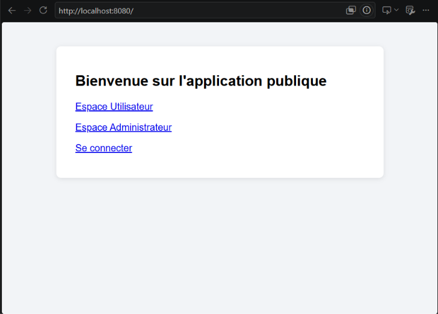
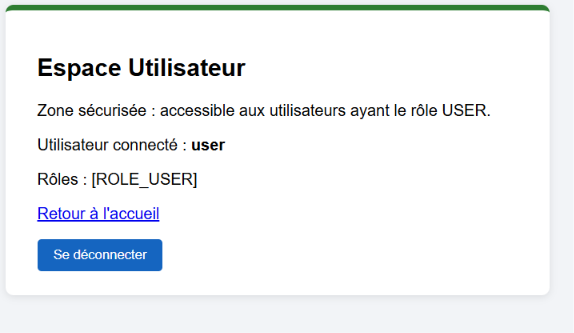
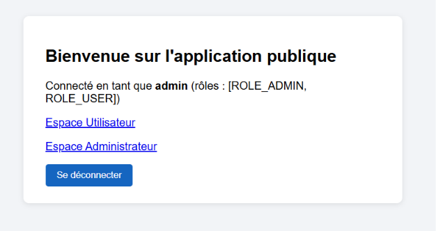
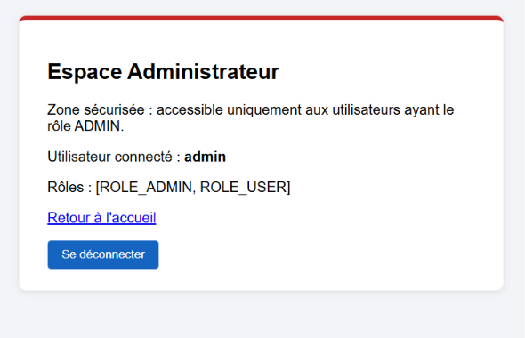
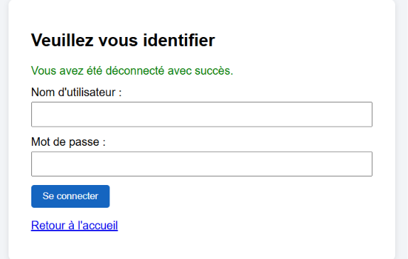

# TP 9 – Authentification en mémoire avec Spring Security

Application Spring Boot démontrant l'authentification en mémoire, l'encodage BCrypt,
la restriction d'accès par rôles et une page de connexion personnalisée.

## Stack

- Java 21, Maven (wrapper `mvnw` inclus)
- Spring Boot 4.1.2 (Spring Web MVC, Thymeleaf, Spring Security)
- `thymeleaf-extras-springsecurity6` pour afficher l'utilisateur connecté dans les vues

## Structure

```
src/main/java/ma/fstg/security/
├── SpringSecurityDemoApplication.java
├── config/
│   ├── SecurityConfig.java         # SecurityFilterChain : règles d'accès, login, logout
│   ├── UserDetailsConfig.java      # Utilisateurs en mémoire (InMemoryUserDetailsManager)
│   └── PasswordEncoderConfig.java  # Bean BCryptPasswordEncoder
└── web/
    └── HomeController.java         # Routes /, /user/dashboard, /admin/dashboard, /login, /access-denied
src/main/resources/
├── templates/  index, user_dashboard, admin_dashboard, login, access_denied (.html)
└── static/css/style.css
```

## Lancement

```bash
./mvnw spring-boot:run        # Windows : mvnw.cmd spring-boot:run
```

Puis ouvrir http://localhost:8080/

## Comptes de test

| Utilisateur | Mot de passe | Rôles       | Accès                                  |
|-------------|--------------|-------------|----------------------------------------|
| `user`      | `1111`       | USER        | `/`, `/user/**`                        |
| `admin`     | `1234`       | ADMIN, USER | `/`, `/user/**`, `/admin/**`           |

## Règles de sécurité

| URL           | Règle                    |
|---------------|--------------------------|
| `/`, `/css/**`| `permitAll()`            |
| `/user/**`    | `hasRole("USER")`        |
| `/admin/**`   | `hasRole("ADMIN")`       |
| `/login`      | page personnalisée, publique |
| autre         | `authenticated()`        |

## Déroulement du TP

1. **Création du projet** avec Spring Initializr (Web, Thymeleaf, Security).
2. **Configuration par défaut** : sans configuration, toutes les routes sont protégées ;
   utilisateur `user` + mot de passe UUID affiché dans la console.
3. **Contrôleur** `HomeController` exposant les trois routes.
4. **Vues Thymeleaf** (note : la syntaxe correcte des liens est `th:href="@{/chemin}"`).
5. **`SecurityFilterChain`** personnalisé.
6. **Utilisateurs en mémoire** avec `{noop}` (mots de passe en clair, développement uniquement).
7. **BCrypt** : `{noop}` remplacé par `passwordEncoder.encode(...)`.
8. **Page de connexion personnalisée** `login.html` + `.loginPage("/login")`.
9. **Tests fonctionnels** (voir ci-dessous).
10. **Bonnes pratiques** (voir ci-dessous).

## Étape 9 – Validation

Tests automatisés (`./mvnw test`) : 9 tests MockMvc, tous verts.

Vérification manuelle sur l'application lancée :

| Scénario                                 | Résultat obtenu                    |
|------------------------------------------|------------------------------------|
| `GET /` anonyme                          | 200                                |
| `GET /user/dashboard` anonyme            | 302 → `/login`                     |
| Login `user` / `1111`                    | 302 → `/user/dashboard`            |
| `user` → `/user/dashboard`               | 200                                |
| `user` → `/admin/dashboard`              | **403** (page « Accès refusé »)    |
| `POST /logout`                           | 302 → `/login?logout`              |
| Login avec mauvais mot de passe          | 302 → `/login?error`               |
| Login `admin` / `1234`                   | 302, accès 200 aux deux espaces    |

### Captures d'écran

**Page d'accueil publique (anonyme)**



**Espace Utilisateur – connecté avec `user` / `1111`**



**Accueil – connecté avec `admin` / `1234` (rôles ADMIN et USER)**



**Espace Administrateur – accessible avec `admin`**



**Déconnexion – retour sur la page de connexion personnalisée**



**CSRF** : la protection CSRF reste activée. `th:action="@{...}"` injecte automatiquement
le champ caché `_csrf` dans les formulaires de connexion et de déconnexion. Pour cette raison,
la déconnexion se fait par un formulaire `POST /logout` et non par un simple lien.

## Étape 10 – Bonnes pratiques appliquées

- **Encodage obligatoire** : mots de passe hachés avec `BCryptPasswordEncoder`.
- **Moindre privilège** : `anyRequest().authenticated()` en fin de chaîne.
- **Centralisation** : règles regroupées dans `SecurityConfig` (`@Configuration` + `@EnableWebSecurity`).
- **Sessions** : la protection CSRF est conservée. Spring Security change l'identifiant de session
  à la connexion, ce qui protège contre la fixation de session. En production, il faudra configurer
  `server.servlet.session.timeout`, des cookies `Secure`/`HttpOnly` et HTTPS.
- L'authentification en mémoire sert au prototypage ; en production, on la remplace
  par un `UserDetailsService` adossé à une base de données.
